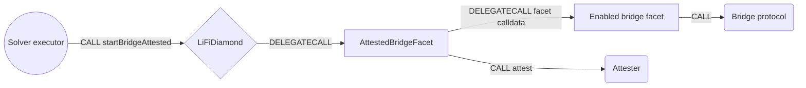

# Attested Bridge Facet

## How it works

The Attested Bridge Facet is a gateway, not a bridge integration. `startBridgeAttested`
runs a call to an existing bridge facet of the Diamond and, in the same transaction,
reports the exact call bytes to an attester contract. A settlement contract that
releases funds to a solver can then rely on the attester's record that those funds left
through a specific bridge call, instead of trusting the solver.



`startBridgeAttested(bytes _facetCalldata, bytes _attesterData)` runs these steps. All
checks run before any external call.

1. `_facetCalldata` shorter than four bytes reverts with `InvalidCallData`.
2. Its selector must be enabled with `setAttestableSelector`, otherwise
   `SelectorNotAttestable`.
3. The Diamond must route the selector to a facet, otherwise `FunctionDoesNotExist`.
4. The contract registered under `BridgeAttester` in the periphery registry must have
   code, otherwise `AttesterNotRegistered`.
5. The facet is delegatecalled with `_facetCalldata`. The bridge runs exactly as on a
   direct call: same `msg.sender`, same `msg.value`, same validation, refunds and
   events. Its return data is discarded and a revert bubbles up unchanged.
6. The attester is called with value 0 and this call's own calldata, with only the
   selector swapped to `attest(bytes,bytes)`. The two functions share their argument
   encoding, so the attester receives `_facetCalldata` and `_attesterData` byte for byte.
   Its return data is discarded. A revert bubbles up unchanged and undoes the bridge, so
   a bridge never completes without its attestation.

One calldata copy serves both calls, which is why the dispatch is inline assembly.

## Who calls it

`startBridgeAttested` is called on the solver and executor path during a fill: a
solver's executor contract calls the Diamond in the transaction that settles an order,
after the order's funds were released to the solver. End users never sign it in a
wallet, so it is on the clear-signing non-user-facing list (`NON_USER_FACING_NAMES` in
`tasks/buildClearSigningProposal.ts`). Its `bytes` argument is an opaque facet call that
an ERC-7730 descriptor could not render.

The function has no access control. It reaches only selectors the Diamond owner
enabled, on the facet the Diamond routes them to, with the caller's own `msg.sender` and
`msg.value`. It opens no facet call path that a direct call does not already have; what
it adds is the attester call.

## The attester

The attester is a separate contract, registered by the Diamond owner with
`registerPeripheryContract("BridgeAttester", attester)`. It is not part of this
repository and implements [`IAttester`](../src/Interfaces/IAttester.sol).

The attester's inputs are caller-controlled. The only guarantee the facet adds is that
the facet call with exactly these bytes succeeded in the same transaction, and that the
Diamond is the caller. An attester must therefore:

- accept `attest` only from the Diamond;
- decode the bridge facts it relies on (asset, amount, receiver, destination chain) from
  `_facetCalldata` itself, and verify anything `_attesterData` claims;
- check those facts against settlement state it can verify on its own, and refuse to
  attest outside such a settlement.

`BridgeAttester` must not be added to `whitelistPeripheryFunctions` in
`config/global.json`. A whitelisted attester could be called from a swap step inside the
Diamond, with the Diamond as `msg.sender` and no bridge behind the call.

The facet holds no funds and sends no value to the attester: `msg.value` stays with the
dispatched facet.

## Attestable selectors

`setAttestableSelector(bytes4 _selector, bool _enabled)` is Diamond owner only
(`OnlyContractOwner`). The set lives in its own Diamond storage namespace
(`com.lifi.library.attestable_selectors`), and each change emits
`AttestableSelectorSet(selector, enabled)`. The facet's own three selectors can never be
enabled (`GatewaySelectorNotAttestable`), so the gateway cannot dispatch itself.

**Enable only bridge entrypoints guarded by `nonReentrant`.** The gateway has no
reentrancy guard of its own (see below).

The owner controls both the selector set and the `BridgeAttester` entry. Disabling a
selector or replacing the attester makes every later call that depends on it revert
until the change is undone.

## Reentrancy

The facet has no `nonReentrant` modifier. It relies on the Diamond's shared guard:
`ReentrancyGuard` keeps its status in one Diamond storage slot
(`com.lifi.reentrancyguard`), so while a guarded bridge facet runs, any re-entry into a
guarded facet, through the gateway or directly, reverts with `ReentrancyError`. The unit
suite covers this with a dispatched facet that re-enters `startBridgeAttested`.

The attester runs after the bridge has returned. Re-entry from the attester reaches the
Diamond as an ordinary external call with the attester as `msg.sender` and no extra
privileges; for example, `setAttestableSelector` still fails the owner check.

## Public Methods

- `function startBridgeAttested(bytes calldata _facetCalldata, bytes calldata _attesterData)`
  - Payable. Dispatches `_facetCalldata` to its facet, then calls `IAttester.attest` on
    the registered attester.
- `function setAttestableSelector(bytes4 _selector, bool _enabled)`
  - Diamond owner only. Enables or disables a bridge entrypoint for
    `startBridgeAttested`.
- `function isAttestableSelector(bytes4 _selector) returns (bool)`
  - Returns whether `startBridgeAttested` may dispatch `_selector`.

The attester interface:

```solidity
/// @param _facetCalldata The bytes the gateway delegatecalled, selector included
/// @param _attesterData Opaque data for the attester
function attest(
  bytes calldata _facetCalldata,
  bytes calldata _attesterData
) external;
```

## Events and Errors

| Name                                                           | Defined in               | Raised when                                                 |
| -------------------------------------------------------------- | ------------------------ | ----------------------------------------------------------- |
| `AttestableSelectorSet(bytes4 indexed selector, bool enabled)` | `LibAttestableSelectors` | `setAttestableSelector` succeeds                            |
| `InvalidCallData()`                                            | `GenericErrors`          | `_facetCalldata` is shorter than four bytes                 |
| `SelectorNotAttestable()`                                      | `AttestedBridgeFacet`    | the selector is not enabled                                 |
| `FunctionDoesNotExist()`                                       | `LibDiamond`             | the Diamond has no facet for the selector                   |
| `AttesterNotRegistered()`                                      | `AttestedBridgeFacet`    | no contract code is registered under `BridgeAttester`       |
| `GatewaySelectorNotAttestable()`                               | `LibAttestableSelectors` | `setAttestableSelector` is called with a gateway selector   |
| `OnlyContractOwner()`                                          | `GenericErrors`          | `setAttestableSelector` is called by anyone but the owner   |
| `ReentrancyError()`                                            | `ReentrancyGuard`        | a guarded facet is re-entered while a dispatched facet runs |

The facet emits no event when it dispatches. The bridge facet emits its usual
`LiFiTransferStarted`, and the attester can record the attestation itself.

## Setup on a chain

The facet has no constructor arguments. Before it can be used, the Diamond owner adds it
with a diamond cut, registers the attester under `BridgeAttester`, and enables each
bridge entrypoint with `setAttestableSelector`.
