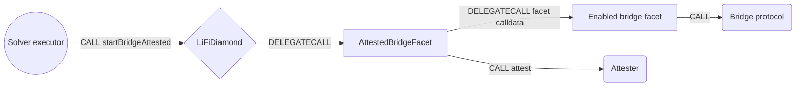

# Attested Bridge Facet

## How it works

The Attested Bridge Facet is a gateway, not a bridge integration. `startBridgeAttested`
runs a call to an existing bridge facet of the Diamond and, in the same transaction,
reports the exact call bytes to an attester contract. A settlement contract that
releases funds to a solver can then rely on the attester's record that those funds left
through a specific bridge call, instead of trusting the solver.



`startBridgeAttested(bytes _facetCalldata, bytes _attesterData)` runs these steps. All
checks run before any external call.

1. `_facetCalldata` shorter than four bytes reverts with `InvalidCallData`.
2. Its selector must be enabled with `setAttestableSelector`, otherwise
   `SelectorNotAttestable`.
3. The Diamond must route the selector to a facet, otherwise `FunctionDoesNotExist`.
4. The contract registered under `BridgeAttester` in the periphery registry must have
   code, otherwise `AttesterNotRegistered`.
5. The facet is delegatecalled with `_facetCalldata`. The bridge runs exactly as on a
   direct call: same `msg.sender`, same `msg.value`, same validation, refunds and
   events. Its return data is discarded and a revert bubbles up unchanged.
6. The attester is called with value 0 as `attest(_facetCalldata, _attesterData)`, so it
   receives the exact bytes the facet ran and the caller's `_attesterData`, ABI-encoded
   afresh. Its return data is discarded. A revert bubbles up unchanged and undoes the
   bridge, so a bridge never completes without its attestation.

## Who calls it

`startBridgeAttested` is called on the solver and executor path during a fill: a
solver's executor contract calls the Diamond in the transaction that settles an order,
after the order's funds were released to the solver. End users never sign it in a
wallet, so it is on the clear-signing non-user-facing list (`NON_USER_FACING_NAMES` in
`tasks/buildClearSigningProposal.ts`). Its `bytes` argument is an opaque facet call that
an ERC-7730 descriptor could not render.

The function has no access control. It reaches only selectors the Diamond owner
enabled, on the facet the Diamond routes them to, with the caller's own `msg.sender` and
`msg.value`. It opens no facet call path that a direct call does not already have; what
it adds is the attester call.

## The attester

The attester is a separate contract, registered by the Diamond owner with
`registerPeripheryContract("BridgeAttester", attester)`. It is not part of this
repository and implements [`IAttester`](../src/Interfaces/IAttester.sol).

The attester's inputs are caller-controlled. The only guarantee the facet adds is that
the facet call with exactly these bytes succeeded in the same transaction, and that the
Diamond is the caller. The attester sees neither the original `msg.sender` nor
`msg.value`: the Diamond calls it with value 0. Who bridged and how much native was sent
can only come from `_facetCalldata`, never from `_attesterData`. An attester must
therefore:

- accept `attest` only from the Diamond;
- decode the bridge facts it relies on (asset, amount, receiver, destination chain) from
  `_facetCalldata` itself, and verify anything `_attesterData` claims;
- check those facts against settlement state it can verify on its own, and refuse to
  attest outside such a settlement.

### What the gateway does not guarantee

The gateway proves only that the Diamond ran a facet call with exactly `_facetCalldata` and
then called the attester. The attester has to establish the rest:

- **Uniqueness.** Two calls can carry byte-identical `_facetCalldata`, so a receipt keyed
  only on its hash merges or replays executions. Bind each receipt to the settlement it
  serves.
- **Swap amounts are floors.** On a `swapAndStartBridgeTokensVia*` call the facet overwrites
  `_bridgeData.minAmount` in memory with the realized swap output, and `AcrossFacetV4`
  recomputes `outputAmount` from `outputAmountMultiplier`. The attester sees the original
  calldata, so those words are lower bounds, not the amounts bridged.
- **Field consistency.** Facets do not require every asset field to agree. On Across V4,
  `_bridgeData.sendingAssetId`, the last swap's `receivingAssetId` and
  `_acrossData.sendingAssetId` can differ. Check the fields the attester relies on against
  each other.
- **Encoding.** A facet can succeed with a malformed dynamic field it never decodes, and
  trailing bytes change the calldata hash without changing what ran. Decode only the fields
  relied on, bounded to `_facetCalldata`, and never key on the raw hash.

`BridgeCommitmentLedger` and its facts adapters in `lifinance/intent-factory` handle each of
these: receipts are counted per commit and validator entry, the adapters treat swap amounts
as floors and pin the Across asset fields, and their decode bounds are covered by
`contracts/test/adapters/`.

`BridgeAttester` must not be added to `whitelistPeripheryFunctions` in
`config/global.json`. A whitelisted attester could be called from a swap step inside the
Diamond, with the Diamond as `msg.sender` and no bridge behind the call. Two checks enforce
this: `script/deploy/bridgeAttesterAllowlist.test.ts` fails CI when config would allowlist
it, and the `bridge-attester-not-allowlisted` health-check invariant fails when the
registered attester has any selector on the Diamond allowlist.

`WithdrawFacet.executeCallAndWithdraw` also lets the Diamond call an arbitrary contract, for
the owner and for any address granted its selector with `setCanExecute`. A grant to a
contract a solver can reach would let it call the attester with no bridge behind the call.
Grants are owner-only, so they pass through the timelock, and the timelock watcher
(`script/deploy/safe/timelock-watcher-verdict.ts`, `gradeAuthority`) alerts on any
`setCanExecute` grant to an address other than the refund wallet or a contract the same
operation installs, while the operation can still be cancelled.

A PR that changes this facet, `AcrossFacetV4`, `PolymerCCTPFacet`,
`LiFiIntentEscrowFacetV2`, or the code that shapes their calldata (`ILiFi`, `LibSwap`,
`SwapperV2`, `IAttester`) fails the
`Intent Factory Review Check` workflow until the `IntentFactoryReviewed` label is set.
Intent Factory's facts adapters decode this calldata, so the check is a reminder to
coordinate with their team. It is not an approval gate: anyone with write access can set
the label, which confirms that the team was consulted or that the change does not affect
them. The label covers the commit it was added at, and a later push removes it.

A selector enabled later with `setAttestableSelector` is a governance action, not a code
change, so this check cannot see it. It fails closed: each Intent Factory adapter accepts
only its own facet's bridge selectors and reverts `UnsupportedSelector` on any other, so
the ledger attests nothing for a selector no adapter supports.

The facet holds no funds and sends no value to the attester: `msg.value` stays with the
dispatched facet.

## Attestable selectors

`setAttestableSelector(bytes4 _selector, bool _enabled)` is Diamond owner only
(`OnlyContractOwner`). The set lives in its own Diamond storage namespace
(`com.lifi.facets.attested_bridge`), and each change emits
`AttestableSelectorSet(selector, enabled)`. The facet's own three selectors can never be
enabled (`GatewaySelectorNotAttestable`), so the gateway cannot dispatch itself. A selector
can be enabled only while the Diamond routes it (`FunctionDoesNotExist` otherwise), so enable
it in the same timelock batch as, or after, the cut that adds its facet. Disabling works on
any selector.

**Enable only bridge entrypoints guarded by `nonReentrant`.** The gateway has no
reentrancy guard of its own (see below).

The owner controls both the selector set and the `BridgeAttester` entry. Disabling a
selector or replacing the attester makes every later call that depends on it revert
until the change is undone.

### Expected set: `attestableSelectors`

`config/global.json` → `attestableSelectors` records which selectors should be enabled,
in the same shape as `config/whitelist.json`: `selectors` maps each selector to
`"<Facet>.<signature>"`, and `networks` lists where that whole set is enabled. Three
checks hold it to the code and the chain:

- `script/deploy/shared/attestableSelectors.test.ts` (TS unit tests): every signature
  hashes to the selector it is listed under, and every network exists and is EVM.
- `AttestableSelectorsConfig.t.sol` (forge tests): every signature is still a function of
  the facet it names in the build. A facet change that alters an enabled entrypoint's
  signature fails in the PR that makes it.
- The `attestable-selectors-match-config` health-check invariant probes
  `isAttestableSelector` for every selector the Diamond routes and every listed one. An
  enabled selector must be listed for that network and must route to the facet address in
  `deployments/<network>.json`; a listed selector that is not enabled yet is a warning,
  since config is merged before the timelocked `setAttestableSelector` executes.

The flag is keyed by selector, so it survives a cut of the facet that serves it, including a
cut that removes the route; dispatch then reverts `FunctionDoesNotExist` until the selector is
routed again. The health check confirms the route, not the new code: when a dispatched
facet is upgraded, confirming it is still `nonReentrant` and that Intent Factory's adapters
still decode it is a review step.

## Reentrancy

The facet has no `nonReentrant` modifier. It relies on the Diamond's shared guard:
`ReentrancyGuard` keeps its status in one Diamond storage slot
(`com.lifi.reentrancyguard`), so while a guarded bridge facet runs, any re-entry into a
guarded facet, through the gateway or directly, reverts with `ReentrancyError`. The unit
suite covers this with a dispatched facet that re-enters `startBridgeAttested`.

The attester runs after the bridge has returned. Re-entry from the attester reaches the
Diamond as an ordinary external call with the attester as `msg.sender` and no extra
privileges; for example, `setAttestableSelector` still fails the owner check.

## Public Methods

- `function startBridgeAttested(bytes calldata _facetCalldata, bytes calldata _attesterData)`
  - Payable. Dispatches `_facetCalldata` to its facet, then calls `IAttester.attest` on
    the registered attester.
- `function setAttestableSelector(bytes4 _selector, bool _enabled)`
  - Diamond owner only. Enables or disables a bridge entrypoint for
    `startBridgeAttested`.
- `function isAttestableSelector(bytes4 _selector) returns (bool)`
  - Returns whether `startBridgeAttested` may dispatch `_selector`.

The attester interface:

```solidity
/// @param _facetCalldata The bytes the gateway delegatecalled, selector included
/// @param _attesterData Opaque data for the attester
function attest(
  bytes calldata _facetCalldata,
  bytes calldata _attesterData
) external;
```

## Events and Errors

| Name                                                           | Defined in            | Raised when                                                                                       |
| -------------------------------------------------------------- | --------------------- | ------------------------------------------------------------------------------------------------- |
| `AttestableSelectorSet(bytes4 indexed selector, bool enabled)` | `AttestedBridgeFacet` | `setAttestableSelector` succeeds                                                                  |
| `InvalidCallData()`                                            | `GenericErrors`       | `_facetCalldata` is shorter than four bytes                                                       |
| `SelectorNotAttestable()`                                      | `AttestedBridgeFacet` | the selector is not enabled                                                                       |
| `FunctionDoesNotExist()`                                       | `LibDiamond`          | the Diamond has no facet for the selector, on dispatch or when `setAttestableSelector` enables it |
| `AttesterNotRegistered()`                                      | `AttestedBridgeFacet` | no contract code is registered under `BridgeAttester`                                             |
| `GatewaySelectorNotAttestable()`                               | `AttestedBridgeFacet` | `setAttestableSelector` is called with a gateway selector                                         |
| `OnlyContractOwner()`                                          | `GenericErrors`       | `setAttestableSelector` is called by anyone but the owner                                         |
| `ReentrancyError()`                                            | `ReentrancyGuard`     | a guarded facet is re-entered while a dispatched facet runs                                       |

The facet emits no event when it dispatches. The bridge facet emits its usual
`LiFiTransferStarted`, and the attester can record the attestation itself.

## Setup on a chain

The facet has no constructor arguments. Before it can be used, the Diamond owner adds it
with a diamond cut, registers the attester under `BridgeAttester`, and enables each
bridge entrypoint with `setAttestableSelector`. Add the network to
`attestableSelectors.networks` in the same rollout PR.
