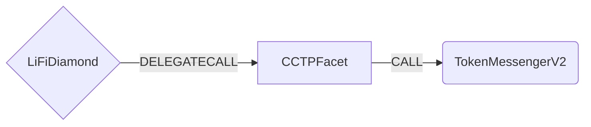

# CCTP Facet

CCTP Facet bridges native USDC through Circle's Cross-Chain Transfer Protocol v2 (CCTP). It burns USDC on the source chain by calling Circle's `TokenMessengerV2` directly, and Circle mints the same amount on the destination chain. The facet takes no fee of its own.

The facet does not custody user funds: USDC enters the diamond and is burned within the same call.

## How it works



- `minFinalityThreshold` selects the transfer speed: `1000` = Fast, `2000` = Standard.
- `maxCCTPFee` is the most CCTP may take from the burned amount on the destination. It is passed to `TokenMessengerV2` unchanged.
- The full `_bridgeData.minAmount` is burned. `LiFiTransferStarted` reports that amount.

### Relation to `PolymerCCTPFacet`

The facet is derived from `PolymerCCTPFacet` v3.1.0 and differs as follows:

- No Polymer fee (`polymerTokenFee`, `POLYMER_FEE_RECEIVER`, `PolymerCCTPFeeSent` are removed).
- `hookData` is accepted for every destination (see [Circle Forwarding Service](#circle-forwarding-service)). `PolymerCCTPFacet` rejects a hook outside HyperCore and Stellar.
- All facet-specific selectors carry `CCTP` in their name, and the facet uses its own storage namespace (`com.lifi.facets.cctp`). Both facets can live on the same diamond.
- The HyperCore and Stellar checks are the same as in `PolymerCCTPFacet` v3.1.0.

## Circle Forwarding Service

For every destination other than HyperCore and Stellar, `hookData` is optional:

- **Empty hook** → `depositForBurn`. Someone has to complete the mint on the destination chain (the user, a relayer, or LI.FI).
- **Non-empty hook** → `depositForBurnWithHook` with the same `mintRecipient` and `destinationCaller = bytes32(0)`. This asks Circle's Forwarding Service to complete the mint (deliver the transfer).

A non-empty hook must start with the 24-byte header `"cctp-forward"` (ASCII, right-padded with zero bytes), otherwise the call reverts with `InvalidCallData`. Circle's composable (version 1) format and the Solana account-creation format both start with that header. The facet does not check anything after the header.

### Trust assumptions

- **A hook cannot redirect funds.** The mint always goes to `mintRecipient`, which the facet sets from validated data: `_bridgeData.receiver` for EVM destinations and `solanaReceiverATA` for Solana. The hook only travels with the burn message.
- **A bad hook only costs delivery.** If Circle cannot use the hook, it does not deliver the transfer. Because `destinationCaller = bytes32(0)`, anyone can still complete the mint with the attested message.
- **The hook is not a destination call.** The header check limits the hook to a delivery request, so `hasDestinationCall` stays `false` and `doesNotContainDestinationCalls` applies.
- **The forwarding fee comes out of `maxCCTPFee`.** When the backend attaches a hook, it quotes Circle's fee API right before the transfer and sets `maxCCTPFee` to cover the CCTP fee plus the forwarding fee. If `maxCCTPFee` is too low, Circle still delivers, but moves the transfer from Fast to Standard.
- **Not every chain is served.** Circle's Forwarding Service delivers to Ethereum, Optimism, Arbitrum, Base, Polygon, Avalanche, Sonic and Solana, but not to Pharos. For transfers into Pharos the backend leaves `hookData` empty and the mint has to be completed by someone else.

## Solana deposits

Solana (`LIFI_CHAIN_ID_SOLANA`, CCTP domain `5`) is non-EVM: `BridgeData.receiver` is the `NON_EVM_ADDRESS` sentinel and the recipient travels in two `CCTPData` fields.

- `solanaReceiverATA`: the recipient's USDC Associated Token Account. This is the CCTP `mintRecipient`, because CCTP mints SPL tokens into a token account, not into a wallet.
- `nonEVMReceiver`: the recipient **owner wallet**. The facet emits it as the receiver in `BridgeToNonEVMChainBytes32`.

Both must be non-zero (`InvalidNonEVMReceiver` for a zero `nonEVMReceiver`, `InvalidConfig` for a zero `solanaReceiverATA`). A Forwarding Service hook is allowed, as for EVM destinations.

### Trust assumptions

- **Unvalidated receiver.** Neither field is a 20-byte EVM address, so the facet cannot check them against `BridgeData.receiver`, and it cannot check on-chain that `solanaReceiverATA` is the USDC ATA of `nonEVMReceiver`. Consistency relies on trusted (LI.FI API) calldata generation.

## HyperCore deposits

Copied unchanged from `PolymerCCTPFacet` v3.1.0; no listed network uses it yet.

HyperCore (LI.FI chain ID `1337`) has no CCTP domain of its own: the burn targets HyperEVM's domain (`19`) and [Circle's `CctpForwarder` on HyperEVM](https://developers.circle.com/cctp/concepts/forwarding-service) deposits the USDC into HyperCore.

- `hookData` is required and must be at least 52 bytes. The recipient at `hookData[32:52]` must equal `BridgeData.receiver` (`InvalidReceiver` otherwise).
- `mintRecipient` and `destinationCaller` are both the hardcoded `HYPERCORE_CCTP_FORWARDER`. Rotating the forwarder requires a facet upgrade.

See [PolymerCCTPFacet.md](./PolymerCCTPFacet.md#hypercore-deposits) for the forwarder's trust assumptions; they apply unchanged.

## Stellar deposits

Copied unchanged from `PolymerCCTPFacet` v3.1.0; no listed network uses it yet.

Stellar (`LIFI_CHAIN_ID_STELLAR`, CCTP domain `27`) is non-EVM. The recipient travels as a strkey inside `hookData`, and every deposit mints to the hardcoded `STELLAR_CCTP_FORWARDER`, which forwards the USDC to the strkey.

- `BridgeData.receiver` must be `NON_EVM_ADDRESS` and `nonEVMReceiver` must be non-zero.
- Hook layout: magic (24) + version (4) + strkey length `L` (4) + strkey (`L`). `L` must be non-zero and equal the actual trailing length.

### Trust assumptions

- **Unvalidated receiver.** The strkey cannot be checked against `BridgeData.receiver` or `nonEVMReceiver` on-chain. Correct routing relies on trusted (LI.FI API) calldata generation. See [PolymerCCTPFacet.md](./PolymerCCTPFacet.md#stellar-deposits).

## Public Methods

- `function startBridgeTokensViaCCTP(BridgeData memory _bridgeData, CCTPData calldata _cctpData)`
  - Bridges USDC via CCTP. Requires an approval of `_bridgeData.minAmount` USDC to the diamond.
- `function swapAndStartBridgeTokensViaCCTP(BridgeData memory _bridgeData, SwapData[] calldata _swapData, CCTPData calldata _cctpData)`
  - Performs swap(s) before bridging USDC via CCTP. The final swap output must be USDC (`InvalidSendingToken` otherwise), and `refundRecipient` must be non-zero (`InvalidCallData` otherwise).
- `function getCCTPChainIdToDomainId(uint256 _chainId)`
  - Returns the configured CCTP domain ID for a LI.FI chain ID. Reverts with `UnsupportedChainId` for an unset chain.
- `CCTP_TOKEN_MESSENGER()` / `CCTP_USDC()`
  - The `TokenMessengerV2` and USDC addresses bound at construction (from `config/cctp.json`).

## Admin Methods

- `function initCCTP(ChainIdConfig[] calldata _chainIdConfigs)`
  - Sets the max USDC approval for `TokenMessengerV2` and writes the chain ID → CCTP domain mappings from `config/cctp.json` (owner-only). Called by the update script when the facet is cut in.
- `function setCCTPChainIdToDomainId(ChainIdConfig[] calldata _chainIdConfigs)`
  - Adds or updates mappings after initialization (owner-only).
- `function unsetCCTPChainIdToDomainId(uint256 _chainId)`
  - Removes a mapping (owner-only).

## CCTP Specific Parameters

```solidity
struct CCTPData {
  // maximum fee to pay on the destination domain, specified in units of burnToken.
  // When hookData requests Circle delivery it must also cover the forwarding fee.
  uint256 maxCCTPFee;
  // The non-EVM recipient emitted in BridgeToNonEVMChainBytes32. Required for Stellar and
  // Solana; for Solana this is the owner wallet (NOT a token account).
  bytes32 nonEVMReceiver;
  // For Solana: the receiver's USDC Associated Token Account, used as the CCTP mintRecipient.
  bytes32 solanaReceiverATA;
  // 1000 = fast path, 2000 = standard path
  uint32 minFinalityThreshold;
  // Recipient of swap leftovers and excess native on the swap entrypoint.
  address refundRecipient;
  // HyperCore / Stellar: required forwarder hook. Any other destination: optional Circle
  // Forwarding Service hook, which must start with the "cctp-forward" header.
  bytes hookData;
}
```

## Deployment

- Constructor arguments come from `config/cctp.json` (`tokenMessengerV2` and `usdc` per network). It is separate from `config/polymercctp.json`, so removing Polymer later does not affect this facet.
- `UpdateCCTPFacet.s.sol` excludes `initCCTP` from the cut and calls it with the `mappings` from `config/cctp.json`.

## Swap Data

Some methods accept a `SwapData _swapData` parameter.

Swapping is performed by a swap specific library that expects an array of calldata to can be run on various DEXs (i.e. Uniswap) to make one or multiple swaps before performing another action.

The swap library can be found [here](../src/Libraries/LibSwap.sol).

## LiFi Data

Some methods accept a `BridgeData _bridgeData` parameter.

This parameter is strictly for analytics purposes. It's used to emit events that we can later track and index in our subgraphs and provide data on how our contracts are being used. `BridgeData` and the events we can emit can be found [here](../src/Interfaces/ILiFi.sol).

## Getting Sample Calls to interact with the Facet

All examples use our [/quote endpoint](https://apidocs.li.fi/reference/get_quote) to retrieve a quote which contains a `transactionRequest`. This request can directly be sent to your wallet to trigger the transaction.

A detailed explanation on how to use the /quote endpoint and how to trigger the transaction can be found [here](https://docs.li.fi/products/more-integration-options/li.fi-api/transferring-tokens-example).

**Hint**: Don't forget to replace `{YOUR_WALLET_ADDRESS}` with your real wallet address in the examples.

### Cross Only

To get a transaction for a transfer from 20 USDC on Ethereum to USDC on Base you can execute the following request:

```shell
curl 'https://li.quest/v1/quote?fromChain=ETH&fromAmount=20000000&fromToken=USDC&toChain=BAS&toToken=USDC&slippage=0.03&allowBridges=cctp&fromAddress={YOUR_WALLET_ADDRESS}'
```

### Swap & Cross

To get a transaction for a transfer from 10 USDT on Ethereum to USDC on Base you can execute the following request:

```shell
curl 'https://li.quest/v1/quote?fromChain=ETH&fromAmount=10000000&fromToken=USDT&toChain=BAS&toToken=USDC&slippage=0.03&allowBridges=cctp&fromAddress={YOUR_WALLET_ADDRESS}'
```
