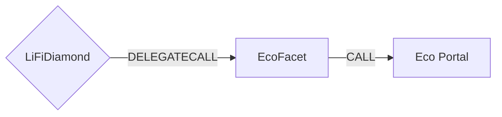

# Eco Facet

## How it works

The Eco Facet enables cross-chain token transfers using the Eco Protocol's intent-based bridging system. It creates an intent that specifies the desired outcome on the destination chain, which solvers then fulfill in exchange for a reward. The facet supports both EVM and non-EVM destination chains through encoded route data.



## Public Methods

- `function startBridgeTokensViaEco(BridgeData memory _bridgeData, EcoData calldata _ecoData)`
  - Bridges tokens using Eco Protocol without performing any swaps
- `function swapAndStartBridgeTokensViaEco(BridgeData memory _bridgeData, LibSwap.SwapData[] calldata _swapData, EcoData calldata _ecoData)`
  - Performs swap(s) before bridging tokens using Eco Protocol

## Eco Specific Parameters

The methods listed above take a variable labeled `_ecoData`. This data is specific to Eco Protocol and is represented as the following struct type:

```solidity
/// @dev Eco specific parameters
/// @param nonEVMReceiver Destination address for non-EVM chains (bytes format)
/// @param prover Address of the prover contract for validation
/// @param rewardDeadline Timestamp for reward claim eligibility
/// @param intentDestination Eco chain ID the route executes on, which
///        differs from `bridgeData.destinationChainId` for CCTP (source
///        chain), HyperCore (HyperEVM), Solana and Tron routes
/// @param encodedRoute Encoded route data containing destination chain routing information
/// @param solanaATA Associated Token Account address for Solana bridging (bytes32)
/// @param refundRecipient Address that receives source-chain leftovers and
///        the reward refund if the intent expires unfulfilled
/// @param deadline Timestamp after which the backend signature is no longer valid
/// @param signature Backend EIP-712 signature over the EcoPayload authorizing this bridge
struct EcoData {
  bytes nonEVMReceiver;
  address prover;
  uint64 rewardDeadline;
  uint64 intentDestination;
  bytes encodedRoute;
  bytes32 solanaATA;
  address refundRecipient;
  uint256 deadline;
  bytes signature;
}
```

### Address Parameters Usage

The receiver address is specified differently depending on the destination chain type:

- **For EVM destination chains** (Ethereum, Optimism, Arbitrum, Base, Polygon, etc.):

  - Set `bridgeData.receiver` to the actual EVM receiver address
  - Leave `nonEVMReceiver` empty (`""`)
  - Leave `solanaATA` as `bytes32(0)`
  - Set `refundRecipient` to the address that should receive refunds (typically the user's address)
  - The contract does not decode the route: the receiver is enforced only by the backend signature (see **Backend Signature** below)

- **For Solana destination chain**:
  - Set `bridgeData.receiver` to `NON_EVM_ADDRESS` constant (`0x11f111f111f111F111f111f111F111f111f111F1`)
  - Provide the Solana address in `nonEVMReceiver` as bytes (base58 address encoded as bytes)
  - Provide the Associated Token Account (ATA) address in `solanaATA` as bytes32
  - Set `refundRecipient` to the address that should receive refunds (typically the user's address)
  - The contract validates that `solanaATA` matches the ATA encoded in the route

- **For Tron destination chain**:
  - Set `bridgeData.receiver` to `NON_EVM_ADDRESS` constant (`0x11f111f111f111F111f111f111F111f111f111F1`)
  - Provide the Tron address in `nonEVMReceiver` as a 32-byte left-padded address (`abi.encode(address)`)
  - Leave `solanaATA` as `bytes32(0)`
  - Set `refundRecipient` to the address that should receive refunds (typically the user's address)
  - The contract validates that `nonEVMReceiver` matches the receiver decoded from the encoded route

Examples:

```solidity
// EVM to EVM bridge (e.g., Optimism to Base)
bridgeData.receiver = 0x123...;      // Actual EVM receiver address
ecoData.intentDestination = 8453;    // Eco chain ID the route executes on
ecoData.nonEVMReceiver = "";         // Empty bytes
ecoData.solanaATA = bytes32(0);      // Zero for EVM chains
ecoData.refundRecipient = msg.sender; // User address for refunds

// EVM to Solana bridge
bridgeData.receiver = NON_EVM_ADDRESS;           // Special constant
ecoData.intentDestination = 1399811149;          // Eco's Solana chain ID
ecoData.nonEVMReceiver = solanaAddressBytes;     // Solana address as bytes
ecoData.solanaATA = 0x8f37c499ccbb92...;         // Solana ATA as bytes32
ecoData.refundRecipient = msg.sender;            // User address for refunds

// EVM to Tron bridge
bridgeData.receiver = NON_EVM_ADDRESS;           // Special constant
ecoData.intentDestination = 728126428;           // Eco's Tron chain ID
ecoData.nonEVMReceiver = abi.encode(tronAddr);   // Tron address, 32-byte left-padded
ecoData.solanaATA = bytes32(0);                  // Zero for Tron
ecoData.refundRecipient = msg.sender;            // User address for refunds
```

### Important Notes

- **Refund Recipient**: The `refundRecipient` parameter specifies where funds will be sent if the intent expires unfulfilled. This is particularly important when using proxy contracts (e.g., Permit2Proxy) as intermediaries. Always set this to the end user's address to ensure they can receive refunds, not the proxy contract address. A zero `refundRecipient` reverts with `InvalidCallData` on both entrypoints.

- **Duplicate Bridge Protection**: The contract prevents duplicate bridge calls with identical parameters. If you attempt to bridge with the same intent parameters twice, the second transaction will revert with an `IntentAlreadyFunded` error. This protects against accidental fund loss.

- **Positive Slippage**: When using `swapAndStartBridgeTokensViaEco`, any positive slippage from the swap (tokens received above `minAmount`) is sent to `refundRecipient`. Only the exact `minAmount` specified is bridged. Unused swap leftovers and excess native are refunded to `refundRecipient`, not `msg.sender`.

- **Native Token Bridging**: The EcoFacet contract does not support native token bridging. Only ERC20 token transfers are supported. Transactions will revert if native tokens are specified as the sending asset.

- **Fee Model**: Eco uses a fee-inclusive model where the fee is already deducted from the source amount:

  - The Eco API returns `sourceAmount` (fee-inclusive amount user sends) and `destinationAmount` (amount received after fee deduction)
  - The total fee is `sourceAmount - destinationAmount`
  - `bridgeData.minAmount` should be set to `sourceAmount` (fee-inclusive)
  - User approves exactly `minAmount`
  - The contract deposits exactly `minAmount` and passes it to the Eco Portal

  **Example**: To bridge 5 USDC with a 0.03 USDC fee:

  - Eco quote: `sourceAmount = 5,000,000`, `destinationAmount = 4,970,000`, fee = 30,000
  - User approves: 5,000,000 USDC (the `sourceAmount`)
  - Contract deposits: 5,000,000 USDC
  - Solver receives: 30,000 USDC
  - Destination receives: 4,970,000 USDC

- **ERC20 Token Bridging**: For ERC20 tokens, the facet automatically approves the Eco Portal to spend `minAmount` (the fee-inclusive amount).

- **Encoded Route**: The `encodedRoute` parameter is provided by the Eco API and contains all necessary routing information for the destination chain. It is required for all bridge operations (an empty route reverts `InvalidConfig`) and is passed to the Eco Portal as-is. For EVM destinations the facet does not decode it; for Tron and Solana it checks the receiver (see below).

- **Intent Destination**: `intentDestination` is the Eco chain ID the route executes on, and the chain the facet publishes the intent to. `bridgeData.destinationChainId` stays the LI.FI chain ID of the chain the receiver is paid on, for analytics. The two differ for:
  - **CCTP routes** (Eco's CCTP fulfillment, swap-and-bridge and bridge-and-swap [intent types](https://docs.eco.com/resources/intent-types)): the route executes on the source chain (for CCTP fulfillment, an approval to Circle's TokenMessengerV2 and a `depositForBurn` call), so `intentDestination` is the source chain ID. In swap-and-bridge, a same-chain intent swaps the source token and then funds the CCTP burn. In bridge-and-swap, CCTP mints to the vault of a second Eco intent on the destination chain that swaps the USDC to the receiver. Eco offers these intent types between EVM chains only; a CCTP route to Solana or Tron reverts `InvalidConfig`, because `intentDestination` would be the source chain while `destinationChainId` is Solana or Tron.
  - **HyperCore** (`bridgeData.destinationChainId = 1337`): the route's `depositFor` executes on HyperEVM, so `intentDestination = 999`.
  - **Solana** (`intentDestination = 1399811149`) and **Tron** (`intentDestination = 728126428`): Eco's chain IDs for these chains.

  The facet reverts `InvalidConfig` if `intentDestination` is 0, or if it is Eco's Solana or Tron ID while `bridgeData.destinationChainId` is not the matching LI.FI chain ID (or the other way round). The Solana and Tron receiver checks are selected by `destinationChainId`, so this stops a payload from skipping them.

- **Backend Signature (trust assumption)**: `encodedRoute`, `intentDestination` and `prover` are opaque, backend-supplied values the facet does not validate on-chain: the route encodes destination calls the facet does not interpret (a transfer, a CCTP burn, a HyperCore deposit, a second Eco intent), and a malicious prover could mark an intent fulfilled without paying the destination. All of them are gated by a backend EIP-712 signature. The LI.FI backend signs an `EcoPayload` that commits to `transactionId`, `sendingAssetId`, `minAmount`, `destinationChainId`, `receiver`, `keccak256(nonEVMReceiver)`, `intentDestination`, `keccak256(encodedRoute)`, `prover`, `refundRecipient`, `rewardDeadline`, `solanaATA`, and `deadline`; the facet recovers the signer and requires it to equal the configured `BACKEND_SIGNER`. `deadline` bounds the signature's validity window. Integrators must obtain `signature` and `deadline` from the LI.FI backend per call.

  **For EVM destinations the receiver is enforced only by this signature, not on-chain.** The signature only proves the backend approved these values, so the backend must validate them before signing: that the route pays `bridgeData.receiver` the quoted amount (for CCTP routes, the burn's `mintRecipient`, `destinationDomain`, `maxFee` and finality threshold, and for bridge-and-swap that the destination intent pays the receiver and refunds to it), that `intentDestination` is the chain the route executes on, and that the route's `portal` is Eco's Portal on that chain.

  - EIP-712 domain: `name = "LI.FI Eco Facet"`, `version = "1"`, `chainId` = the source chain, `verifyingContract` = the LiFiDiamond address.

- **TRON Handling**: Tron follows the non-EVM receiver convention (`bridgeData.receiver` set to `NON_EVM_ADDRESS`, real recipient in `nonEVMReceiver`), matching the backend's generic non-EVM bridge-data builder and the other non-EVM facets. Because Tron uses the same Route struct encoding as EVM chains, the facet checks that the route's final call is a TRC20 `transfer` to `nonEVMReceiver` (otherwise `InvalidReceiver`); a `BridgeToNonEVMChainBytes32` event is emitted. Solana keeps its own handling via `nonEVMReceiver` (base58 bytes) and `solanaATA`.

- **Solana ATA Validation**: For Solana bridges, the contract validates that the Associated Token Account (ATA) specified in `solanaATA` matches the ATA encoded in bytes 251-283 of the route. The ATA is derived from the user's wallet address and the SPL token mint address, not the user's wallet address directly.

## Swap Data

Some methods accept a `SwapData _swapData` parameter.

Swapping is performed by a swap specific library that expects an array of calldata to can be run on various DEXs (i.e. Uniswap) to make one or multiple swaps before performing another action.

The swap library can be found [here](../src/Libraries/LibSwap.sol).

## LiFi Data

Some methods accept a `BridgeData _bridgeData` parameter.

This parameter is strictly for analytics purposes. It's used to emit events that we can later track and index in our subgraphs and provide data on how our contracts are being used. `BridgeData` and the events we can emit can be found [here](../src/Interfaces/ILiFi.sol).

## Getting Sample Calls to interact with the Facet

In the following some sample calls are shown that allow you to retrieve a populated transaction that can be sent to our contract via your wallet.

All examples use our [/quote endpoint](https://apidocs.li.fi/reference/get_quote) to retrieve a quote which contains a `transactionRequest`. This request can directly be sent to your wallet to trigger the transaction.

The quote result looks like the following:

```javascript
const quoteResult = {
  id: '0x...', // quote id
  type: 'lifi', // the type of the quote (all lifi contract calls have the type "lifi")
  tool: 'eco', // the bridge tool used for the transaction
  action: {}, // information about what is going to happen
  estimate: {}, // information about the estimated outcome of the call
  includedSteps: [], // steps that are executed by the contract as part of this transaction, e.g. a swap step and a cross step
  transactionRequest: {
    // the transaction that can be sent using a wallet
    data: '0x...',
    to: '0x...',
    value: '0x00',
    from: '{YOUR_WALLET_ADDRESS}',
    chainId: 100,
    gasLimit: '0x...',
    gasPrice: '0x...',
  },
}
```

A detailed explanation on how to use the /quote endpoint and how to trigger the transaction can be found [here](https://docs.li.fi/products/more-integration-options/li.fi-api/transferring-tokens-example).

**Hint**: Don't forget to replace `{YOUR_WALLET_ADDRESS}` with your real wallet address in the examples.

### Cross Only

To get a transaction for a transfer from 5 USDC on Optimism to USDC on Base you can execute the following request:

```shell
curl 'https://li.quest/v1/quote?fromChain=OPT&fromAmount=5000000&fromToken=USDC&toChain=BAS&toToken=USDC&slippage=0.03&allowBridges=eco&fromAddress={YOUR_WALLET_ADDRESS}'
```

### Swap & Cross

To get a transaction for a transfer from 5 USDT on Optimism to USDC on Base you can execute the following request:

```shell
curl 'https://li.quest/v1/quote?fromChain=OPT&fromAmount=5000000&fromToken=USDT&toChain=BAS&toToken=USDC&slippage=0.03&allowBridges=eco&fromAddress={YOUR_WALLET_ADDRESS}'
```
